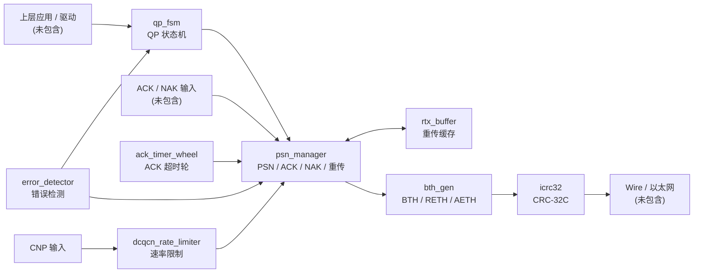

# RDMA RTL Engine

> 面向 FPGA/ASIC 验证的 RDMA 发送路径 RTL 原型，使用 SystemVerilog 实现，配套 VCS 行为级 testbench 与中文设计文档。

<p align="left">
  
  
  
  
  
</p>

## 1. 项目概览

本仓库实现 RDMA 发送路径的核心 RTL 模块，重点覆盖 BTH 头生成、QP 状态机、PSN 窗口管理、ACK/NAK/超时重传、重传缓存、错误检测、ICRC32 校验和 DCQCN 速率控制。

当前版本为 **v0.2.0**，包含 9 个 RTL 源文件（1 个 package + 8 个模块）、1 个行为级 testbench，以及 `sim/` 下的 VCS 编译/仿真脚本。最近一次干净回归结果：

```text
Test Summary: PASS=54  FAIL=0
ALL TESTS PASSED
```

**重要说明**：本仓库是 RTL 原型与验证工程，不是完整 RDMA 协议栈。当前**没有顶层集成、没有 RX 路径、没有 DMA/MPT/MTT/队列管理、没有综合约束，也未上板验证**。部分模块存在已知功能缺陷，详见第 9 节。

## 2. 仓库信息

| 项目 | 内容 |
|---|---|
| 项目状态 | RTL 原型，行为级仿真通过 |
| RTL 语言 | SystemVerilog |
| 仿真器 | Synopsys VCS V-2023.12-SP1 |
| 测试规模 | 13 组，54 项检查 |
| 最近结果 | `PASS=54  FAIL=0` |
| 顶层模块 | 未提供 |
| 综合/上板 | 未提供 |
| 文档语言 | 中文 |
| 默认分支 | `main` |

## 3. 功能特性

- **BTH/RETH/AETH 头生成**：支持基础 BTH，以及可选的 RETH、AETH 扩展头。
- **QP 状态机**：支持 `RESET / INIT / RTR / RTS / SQE / ERROR` 六种状态。
- **PSN 窗口管理**：发送 PSN 递增、累计 ACK、NAK、超时和 RNR 重传。
- **Go-Back-N 重传**：重传时回退到 `base_psn`，重试次数可配置。
- **重传缓存**：按 PSN 缓存发送数据，支持 ACK 后释放（当前实现存在 P0 缺陷）。
- **ACK 超时轮**：256 个 slot、4 位预分频，每 16 个时钟周期推进一个 slot。
- **错误检测**：支持 retry、RKEY、ADDR、RNR、LINK、ICRC 六类错误及优先级。
- **ICRC32**：CRC-32C（Castagnoli）逐字节计算，兼容标准测试向量。
- **DCQCN 原型**：CNP 降速、定时增率、token 授权（当前实现存在 P0 缺陷）。

## 4. 架构与数据流

下图是**概念数据流**，用于说明模块职责；当前仓库尚未提供把这些模块连接起来的顶层 RTL。



### 4.1 典型发送流程

1. `qp_fsm` 进入 `QP_RTS`，允许发送。
2. `psn_manager` 分配当前 `tx_psn_o`，在 `tx_en_i && tx_ready_o` 时推进 head PSN。
3. 发送数据写入 `rtx_buffer`，同时由 `bth_gen` 生成 BTH/RETH/AETH。
4. `icrc32` 对报文计算 ICRC，输出到下游。
5. 收到 ACK 后，`psn_manager` 推进 `base_psn`，并通知 `rtx_buffer` 释放已确认条目。
6. 收到 NAK 或 ACK 超时后，`psn_manager` 回退到 `base_psn` 并启动重传。
7. 重试次数超过 `MAX_RETRY`，或检测到不可恢复错误时，进入 `QP_ERROR`。

> 注意：上述流程是设计意图。由于当前没有顶层集成，模块之间的握手、错误脉冲锁存、timer 冲突处理需要集成层自行实现。

## 5. 模块清单

| 模块 | 文件 | 主要功能 | 关键参数/接口 | 状态 |
|---|---|---|---|---|
| `rdma_pkg` | `rtl/rdma_pkg.sv` | 公共位宽、opcode、QP 状态、BTH/RETH/AETH、错误类型 | `PSN_W=24`, `QPN_W=24`, `ADDR_W=64`, `RKEY_W=32` | 稳定 |
| `bth_gen` | `rtl/bth_gen.sv` | 生成 BTH，可选 RETH/AETH | `hdr_en_i`, `reth_en_i`, `aeth_en_i` | 可用，无 ready 反压 |
| `qp_fsm` | `rtl/qp_fsm.sv` | QP 状态机与命令处理 | `cmd_i`, `can_send_o`, `can_recv_o` | 稳定 |
| `psn_manager` | `rtl/psn_manager.sv` | PSN 窗口、累计 ACK、NAK/超时/RNR 重传 | `WIN_SIZE=64`, `MAX_RETRY=7`, `RNR_MAX=7` | 可用，有 P1 问题 |
| `rtx_buffer` | `rtl/rtx_buffer.sv` | 重传数据缓存与 ACK 释放 | `BUF_DEPTH=256`, `DATA_W=64` | **P0 缺陷** |
| `ack_timer_wheel` | `rtl/ack_timer_wheel.sv` | ACK 超时计时 | `QP_NUM=1024`, `SLOT_NUM=256` | 可用，有 P1 问题 |
| `error_detector` | `rtl/error_detector.sv` | 错误分类、优先级、复位/重传请求 | 6 类错误 | 稳定 |
| `icrc32` | `rtl/icrc32.sv` | CRC-32C 逐字节计算 | 多项式 `0x82F63B78` | 稳定 |
| `dcqcn_rate_limiter` | `rtl/dcqcn_rate_limiter.sv` | CNP 降速、定时增率、token 授权 | `rate`, `alpha`, `token_cnt` | **P0 缺陷** |

### 5.1 关键接口约定

- 所有模块使用单时钟 `clk_i` 和异步低有效复位 `rst_n_i`。
- `bth_gen` 的 `bth_valid_o/reth_valid_o/aeth_valid_o` 是单周期脉冲，没有 ready/反压。
- `psn_manager` 的发送接口使用 `tx_en_i/tx_ready_o` 握手；ACK/NAK 输入需要由集成层做跨时钟域同步。
- `error_detector` 的 `err_valid_o` 是单周期脉冲，`err_type_o` 保持最后一次错误类型，集成层需要锁存。
- `ack_timer_wheel` 的 `timeout_val` 是 slot 偏移，不是时间单位；每 16 个时钟周期推进一个 slot。
- `rtx_buffer` 的 ACK 释放使用简单数值比较，未处理 24 位 PSN 回绕。

## 6. 目录结构

```text
rdma_rtl/
├── rtl/
│   ├── rdma_pkg.sv
│   ├── bth_gen.sv
│   ├── qp_fsm.sv
│   ├── psn_manager.sv
│   ├── rtx_buffer.sv
│   ├── ack_timer_wheel.sv
│   ├── error_detector.sv
│   ├── icrc32.sv
│   └── dcqcn_rate_limiter.sv
├── tb/
│   └── tb_rdma_engine.sv
├── sim/
│   ├── Makefile
│   ├── filelist_rtl.f
│   ├── filelist_tb.f
│   ├── synopsys_sim.setup
│   └── dump_fsdb_vcs.tcl
├── doc/
│   ├── 功能手册.md
│   ├── 修改手册.md
│   └── CHANGELOG.md
├── .gitignore
└── README.md
```

## 7. 快速开始

### 7.1 环境要求

- Synopsys VCS，已验证版本：`V-2023.12-SP1`
- 可用的 VCS license
- Linux 环境（脚本使用 `bash` 和 `make`）

按实际环境设置：

```bash
source <VCS 安装目录>/env.sh
export LM_LICENSE_FILE=<your_license_server>
# 如环境设置了 VCS_ARCH_OVERRIDE，建议先取消
unset VCS_ARCH_OVERRIDE
```

### 7.2 编译与仿真

```bash
cd rdma_rtl/sim
make clean
make run
```

`make run` 依次执行：

1. `vlogan` 分析 RTL 到 `lib_rtl`
2. `vlogan` 分析 testbench 到 `lib_tb`
3. `vcs`  elaboration
4. `simv` 运行仿真并生成 FSDB

### 7.3 预期输出

```text
Test Summary: PASS=54  FAIL=0
ALL TESTS PASSED
```

仿真日志位于 `sim/tb_rdma_engine_simulation.log`。生成的 `simv`、`*.log`、`*.fsdb`、`lib_rtl/`、`lib_tb/` 等文件已被 `.gitignore` 排除。

## 8. 测试覆盖

| 测试组 | 检查项 | 覆盖内容 |
|---|---:|---|
| QP FSM | 9 | 复位、状态迁移、非法命令、错误跳转 |
| BTH | 8 | 字段拼接、可选 RETH/AETH、valid 脉冲 |
| PSN | 3 | 初始 PSN、发送递增、窗口边界 |
| ACK | 2 | 累计 ACK、base 推进 |
| NAK | 5 | NAK 触发重传、重传计数、窗口回退 |
| Timeout | 3 | 超时触发、重传、定时器行为 |
| Retry Limit | 1 | 超过最大重试进入 ERROR |
| RTX Buffer | 4 | 写入、读取、ACK 释放（注：当前预期值固化了缺陷行为） |
| AETH | 3 | ACK/NAK/RNR 编码 |
| ACK Timer | 3 | 启动、取消、超时 |
| Error Detector | 8 | 6 类错误、优先级、复位/重传请求 |
| ICRC32 | 2 | 标准向量 `123456789` → `0xE3069283` |
| DCQCN | 3 | 授权、CNP、增率（注：Test 13 存在假通过） |
| **合计** | **54** | 13 组 |

### 8.1 测试可信度说明

- **Test 8** 期望 `rtx_usage=3`，这是 `rtx_buffer` 使用 `buf_valid` 位图作为 `usage_cnt` 的结果；它验证的是当前错误实现，不是“两条记录”的正确语义。
- **Test 13** 的 `dcqcn_rate_decreased` 通过，很可能由 `rate + (rate >> 4)` 的 32 位溢出造成，不能证明 CNP 降速有效。

在修复 P0 缺陷时，必须同步修正这两个测试的预期值，否则回归会继续“假通过”。

## 9. 已知问题与限制

| 优先级 | 模块 | 问题 | 影响 |
|---|---|---|---|
| P0 | `rtx_buffer` | 写索引使用 `buf_valid` 位图值，不是独立写指针 | 连续写入索引跳变，可能覆盖或稀疏存储 |
| P0 | `rtx_buffer` | `usage_cnt` 是 `buf_valid` 低 8 位，不是条目计数 | 容量统计不可靠，Test 8 固化了错误语义 |
| P0 | `dcqcn_rate_limiter` | `alpha` 初值为 0，CNP 降速量恒为 0 | CNP 降速不生效 |
| P0 | `dcqcn_rate_limiter` | `max_rate_i` 未使用；token 不消费；增率可能溢出 | 速率控制模型不真实，Test 13 假通过 |
| P1 | `psn_manager` | 任意 `ack_valid_i` 都会清 `rtx_active_r`，包括窗口外 ACK | 可能提前终止重传 |
| P1 | `ack_timer_wheel` | 每个 slot 只能存一个 QPN，无冲突处理 | 同 slot 多 timer 互相覆盖 |
| P1 | `rtx_buffer` | ACK 释放使用 `buf_psn <= ack_msn`，未处理 PSN 回绕 | 回绕时可能错误释放 |
| P2 | 全局 | 无顶层集成、无 RX、无 DMA/MPT/MTT/队列管理 | 不能直接上板 |
| P2 | 全局 | 无 SVA、覆盖率、随机测试、综合约束 | 验证深度和可实现性不足 |

完整分析、修改步骤和验收标准见 [修改手册](doc/修改手册.md)。

## 10. 文档

- [功能手册](doc/功能手册.md)：模块接口、参数、时序、错误处理、测试覆盖和已知限制。
- [修改手册](doc/修改手册.md)：工程结构、构建回归、逐模块修改指南、常见修改场景、v0.3.0 修复计划。
- [CHANGELOG](doc/CHANGELOG.md)：v0.1.0 → v0.2.0 的变更记录。

## 11. 版本记录

### v0.2.0 — 2026-11-11

- 新增 `ack_timer_wheel.sv`、`error_detector.sv`、`icrc32.sv`、`dcqcn_rate_limiter.sv`。
- testbench 新增 Test 10–13，共 16 项检查。
- 检查总数由 38 增至 54。
- 新增功能手册、修改手册和 CHANGELOG。

### v0.1.0 — 2026-11-11

- 初始版本：`rdma_pkg`、`bth_gen`、`qp_fsm`、`psn_manager`、`rtx_buffer`。
- 初始 testbench，38 项检查。
- 修复 PSN manager ACK 越界问题。

## 12. 后续规划

### v0.3.0：修复 P0

- 重写 `rtx_buffer` 写指针、条目计数和 ACK 释放逻辑。
- 修复 `dcqcn_rate_limiter` 的 alpha 更新、CNP 降速、token 消费和 `max_rate_i` 限幅。
- 更新 Test 8 和 Test 13，消除假通过。

### v0.4.0：集成与扩展

- 增加 `rdma_tx_engine` 顶层，连接 QP、PSN、RTX、BTH、ICRC、timer 和 error detector。
- 增加 RX 路径、ACK/NAK 生成、包解析和 CRC 校验。
- 增加 AXI/DMA 接口与队列管理。

### v0.5.0：验证与实现

- 增加 SVA、功能覆盖率和随机测试。
- 增加综合约束、时序分析和资源评估。
- 在 FPGA 上完成回环验证。

## 13. 设计约定

- **时钟/复位**：单时钟 `clk_i`，异步低有效复位 `rst_n_i`。
- **命名**：输入 `_i`、输出 `_o`、寄存器 `_r`、低有效 `_n`。
- **参数化**：位宽和深度通过 `parameter` 定义，但部分参数有隐式上限（如 `MAX_RETRY` 被截成 3 位）。
- **脉冲信号**：`bth_valid_o`、`err_valid_o` 等为单周期脉冲，集成层需按 valid 采样。
- **无顶层**：当前仓库只提供模块级 RTL，模块间连接关系需在顶层集成时明确。

## 14. 贡献与许可

本仓库当前为私有项目，未指定开源许可证，默认保留所有权利。若需要对外开源，请先补充 `LICENSE` 并确认代码中不包含内部接口、license 配置或敏感信息。

提交修改前建议：

1. 运行 `cd sim && make clean && make run`，确认 `PASS=54 FAIL=0`。
2. 同步更新 `doc/功能手册.md`、`doc/修改手册.md` 和 `doc/CHANGELOG.md`。
3. 不要提交 `simv`、`*.log`、`*.fsdb`、`lib_rtl/`、`lib_tb/` 等生成文件。
4. 若修改接口或参数，必须全链路同步 RTL、testbench、文档和集成示例。
